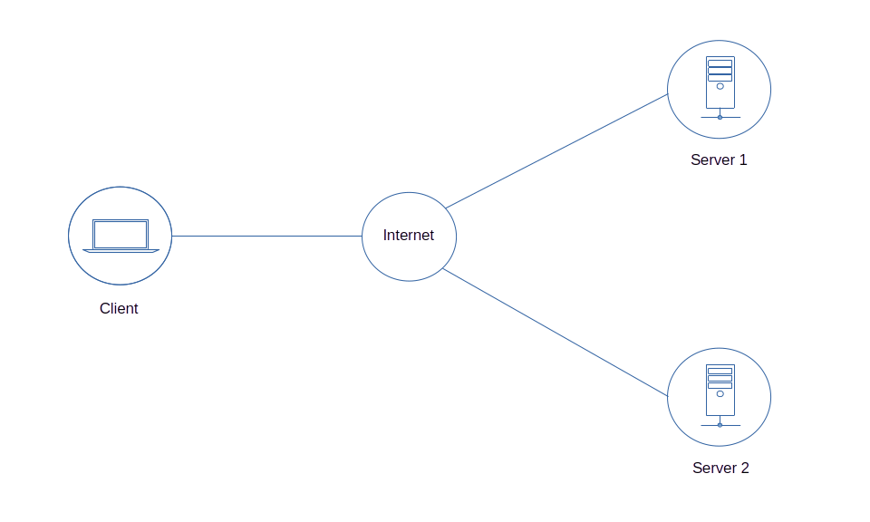

# Quick Tour
   1. [Cloud Computing](#cloud-computing)
   2. [Cloud Browser Client](#cloud-browser-client)
   3. [Edge Computing Using Local Area Networking](https://github.com/Node-M2M/m2m-edge-example)
   4. [Create an Edge Gateway](https://github.com/Node-M2M/edge-gateway)
   5. [Create a Cloud Bridge Gateway](https://github.com/Node-M2M/m2m-bridge-gateway)
   6. [Create a Load Balancer Server for Edge Computing](https://github.com/Node-M2M/edge-load-balancing)
   7. [Cloud Server-To-Server Communication](https://github.com/Node-M2M/m2m-server-to-server-communication)
   8. [Edge Raspberry Pi GPIO Access](https://github.com/Node-M2M/edge-rpi-gpio-access)

<!--- [API Reference](https://github.com/Node-M2M/M2M-API) --->

---

<br>

# Cloud Computing

[](https://raw.githubusercontent.com/EdoLabs/src2/master/quicktour.svg?sanitize=true)

[Create an account](https://www.node-m2m.com/m2m/account/create) and register your server endpoints.

## Server 1 Setup

#### Create server 1 project directory and install *m2m*.

```js
$ npm install m2m
```
#### 1. Save the code below as *server.js* in your project directory.

Connect using callback
```js
const m2m = require('m2m')

// Create a cloud server (cs) with a server id of 100
let cs = new m2m.Cloud({type:'server', id:100}) 

let serverMsg = 'node-m2m is amazing'

// Generate a random number
function genRandomInt(min, max) {
  return Math.floor(Math.random() * (max - min + 1)) + min
}

m2m.connect((result) => {
  console.log(result) // success

  // Create publish resource with a topic of 'random-number' 
  cs.publish('random-number', (ws) => {
    let rn = genRandomInt(15, 100)
    ws.send({id:ws.id, topic:ws.topic, value:rn}) 
  })

  // Create read resource using 'read-server-msg' topic
  cs.read('read-server-msg', (ws) => {
    ws.send({id:ws.id, topic:ws.topic, message:serverMsg}) 
  })

  // Create write resource using 'write-server-msg' topic
  cs.write('write-server-msg', (ws) => {
    if(ws.payload){
      serverMsg = ws.payload.message
    }	
    ws.send({id:ws.id, topic:ws.topic, message:serverMsg}) 
  })
})
```
#### 2. Start server 1 application.

```js
$ node server.js
```

The first time you run your application, &nbsp;it will ask for your userid and password credentials.
```js
? Enter your userid (email):
? Enter your password:

```
The next time you run your application, &nbsp;it will start automatically using a saved user token.

At anytime, &nbsp;if you're having difficulty or issues restarting your application, &nbsp;you can re-authenticate with an `-r` flag. This will refresh your token as shown below.
```js
$ node server.js -r
```
## Server 2 Setup
#### Create server 2 project directory and install *m2m*.
```js
$ npm install m2m
```
#### 1. Save the code below as *server.js* in your server 2 project directory.
Connect using async/await
```js
const m2m = require('m2m')

let cs = m2m.Cloud({type:'server', port:200}) 

function genRandomInt(min, max) {
  return Math.floor(Math.random() * (max - min + 1)) + min
}

let main = async () => {
  let result = await cs.connect()
  console.log(result) // success

  cs.publish('random-number', (ws) => {
    let rn = genRandomInt(10, 50)
    ws.send({id:ws.id, topic:ws.topic, value:rn})
  })

  // http get resource with '/update-server-data/:id/new-data/:data' path
  cs.get('/update-server-data/:id/new-data/:data', (req, res) => {
    res.send({id:res.id, query:req.query, params:req.params})
  })

  // http post resource with '/machine-control/:id/actuator/:number/action/:state' path
  cs.post('/machine-control/:id/actuator/:number/action/:state', (req, res) => {
    res.send({id:res.id, path:res.path, query:req.query, params:req.params})
  })    
}

main()
```

#### 2. Start server 2 application.

```js
$ node server.js
```

## Client Setup

#### 1. Save the code below as *client.js* in your client project directory.

**Method 1:** &nbsp; Access each server using the access method

Connect using promise
```js
const m2m = require('m2m')

let cc = m2m.Cloud({type:'client', name:'cloud-client-1'})

m2m.connect()
.then(console.log) // success
.catch(console.log)
.then(async () => {
  let c1 = cc.access(100)
  let c2 = cc.access(200)

  try{
    let r1 = await c1.read('read-server-msg')
    console.log('result1', r1)

    let r2 = await c1.write('write-server-msg', {message:'node-m2m is awesome'})
    console.log('result2', r2)

    let r3 = await c1.read('read-server-msg')
    console.log('result3', r3)

    let gr = await c2.get('/update-server-data/320/new-data/'+JSON.stringify({pet:'cat', name:'Captain'})+'?name=Rv')
    console.log('get result', gr)

    let pr = await c2.post('/machine-control/150/actuator/5/action/on?name=Ed', {id:200, state:'true'})
    console.log('post result', pr)
  }
  catch(e){
    console.log('cc error:', e.message)
  }

  // use the default 5 secs poll interval 
  c1.subscribe('random-number', (data) => {
    console.log('client1 subscribe random-number', data)
  })

  // use the shorthand sub method instead of subscribe and set the poll interval to 13 secs 
  c2.sub({topic:'random-number', pollInterval:13000}, (data) => {
    console.log('client2 subscribe random-number', data)
  })

  setTimeout(async () => {
    // using an asynchronous callback for the result
    c1.unsubscribe('random-number', (result) => { 
      console.log('client1 unsub', result) // true if successful
    })
  }, 20000)

  setTimeout(async () => {
    try{
      // use the shorthand unsub method instead of unsubscribe 
      let result = await c2.unsub('random-number')
      console.log('client2 unsub', result) // true if successful
    }
    catch(e){
      console.log('client2 error:', e.message)
    }
  }, 40000)
})
```

**Method 2:** &nbsp; Access each server directly from the client object by providing the server id  
```js
const m2m = require('m2m')

let cc = m2m.Cloud({type:'client', name:'cloud-client-2'})

cc.connect()
.then(console.log) // success
.catch(console.log)
.then(async () => {
  try{
    let r1 = await cc.read(100, 'read-server-msg')
    console.log('result1', r1)

    let r2 = await cc.write(100, 'write-server-msg', {message:'node-m2m is awesome'})
    console.log('result2', r2)

    let r3 = await cc.read(100, 'read-server-msg')
    console.log('result3', r3)

    let gr = await cc.get(200, '/update-server-data/320/new-data/'+JSON.stringify({pet:'cat', name:'Captain'})+'?name=Rv')
    console.log('get result', gr)

    let pr = await cc.post(200, '/machine-control/150/actuator/5/action/on?name=Ed', {id:200, state:'true'})
    console.log('post result', pr)
  }
  catch(e){
    console.log('cloud client error:', e.message)
  }
	
  // set a poll interval of 10 secs
  cc.sub(100, 'random-number', 10000, (data) => {
    console.log('client1 subscribe random-number', data)
  })

  // use the default 5 secs poll interval
  cc.sub(200, 'random-number', (data) => {	
    console.log('client2 subscribe random-number', data)
  })

  setTimeout(async () => {
    try{
      let result = await cc.unsub(100, 'random-number')
      console.log('client1 unsub', result)
    }
    catch(e){
      console.log('client1 error:', e.message)
    }
  }, 40000)

  setTimeout(async () => {
    cc.unsub(200, 'random-number', (result) => { 
      console.log('client2 unsub', result) // true if successful
    })
  }, 20000)
})
```

#### 3. Start client application.
```js
$ node client.js
```
You should get a similar output result as shown below.
```js
result1 { id: 100, topic: 'read-server-msg', message: 'node-m2m is awesome' }
result2 { id: 100, topic: 'write-server-msg', message: 'node-m2m is awesome' }
result3 { id: 100, topic: 'read-server-msg', message: 'node-m2m is awesome' }
get result {
  id: 200,
  query: { name: 'Rv' },
  params: { id: '320', data: '{"pet":"cat","name":"Captain"}' }
}
post result {
  id: 200,
  path: '/machine-control/150/actuator/5/action/on?name=Ed',
  query: { name: 'Ed' },
  params: { id: '150', number: '5', state: 'on' }
}
client1 subscribe random-number { id: 100, topic: 'random-number', value: 60 }
client2 subscribe random-number { id: 200, topic: 'random-number', value: 31 }
client2 subscribe random-number { id: 200, topic: 'random-number', value: 40 }
client2 subscribe random-number { id: 200, topic: 'random-number', value: 46 }
client2 subscribe random-number { id: 200, topic: 'random-number', value: 31 }
client1 subscribe random-number { id: 100, topic: 'random-number', value: 94 }
client2 subscribe random-number { id: 200, topic: 'random-number', value: 38 }
client2 unsub true
client1 subscribe random-number { id: 100, topic: 'random-number', value: 17 }
client1 subscribe random-number { id: 100, topic: 'random-number', value: 29 }
client1 unsub true

```
<br>

## Cloud Browser Client

<br>

Using the available resources from the example above.
### Browser Client Setup

#### 1. Login to [node-m2m](https://www.node-m2m.com/m2m/account/login) and create a web access token. 

From the *manage security* section in the main menu under the *user account* tab, &nbsp;generate a web access token.

#### 2. Install *m2m* in your web server.

```js
$ npm install m2m
```

From `node_modules/m2m/dist` directory, &nbsp;copy `node-m2m.min.js` file into your web server's public javascript directory.

#### 3. Create a client instance from the global NodeM2M object.

```js
<script src="/javascripts/node-m2m.min.js"></script>

<script> 

const { Cloud } = NodeM2M(); 

let cc = new Cloud({type:'client', name:'cloud-browser-client', location:'Austin, Texas'}) 

// web access token
let tkn = 'fce454138116159a6ad9a4234e71de810a1087fa9e7fbfda74503d9f52616fc5';

client.connect({server:'https://www.node-m2m.com', accessTkn:tkn})
.catch(console.log)
.then(console.log) // success
.then(async () => {   
  try{
    let r1 = await cc.read(100, 'read-server-msg')
    console.log('result1', r1)

    let r2 = await cc.write(100, 'write-server-msg', {message:'node-m2m is awesome'})
    console.log('result2', r2)

    let r3 = await cc.read(100, 'read-server-msg')
    console.log('result3', r3)

    let gr = await cc.get(200, '/update-server-data/320/new-data/'+JSON.stringify({pet:'cat', name:'Captain'})+'?name=Rv')
    console.log('get result', gr)

    let pr = await cc.post(200, '/machine-control/150/actuator/5/action/on?name=Ed', {id:200, state:'true'})
    console.log('post result', pr)
  }
  catch(e){
    console.log('cloud client error:', e.message)
  }
	
  // set a poll interval of 10 secs
  cc.sub(100, 'random-number', 10000, (data) => {
    console.log('client1 subscribe random-number', data)
  })

  // use the default 5 secs poll interval
  cc.sub(200, 'random-number', (data) => {	
    console.log('client2 subscribe random-number', data)
  })

  setTimeout(async () => {
    try{
      let result = await cc.unsub(100, 'random-number')
      console.log('client1 unsub', result)
    }
    catch(e){
      console.log('client1 error:', e.message)
    }
  }, 40000)

  setTimeout(async () => {
    cc.unsub(200, 'random-number', (result) => { 
      console.log('client2 unsub', result) // true if successful
    })
  }, 20000)
})

</script>
```

You should get a near similar output result as shown below. 
```js
success
result1 { id: 100, topic: 'read-server-msg', message: 'node-m2m is awesome' }
result2 { id: 100, topic: 'write-server-msg', message: 'node-m2m is amazing' }
result3 { id: 100, topic: 'read-server-msg', message: 'node-m2m is amazing' }
get result {
  id: 200,
  query: { name: 'Rv' },
  params: { id: '320', data: '{"pet":"cat","name":"Captain"}' }
}
post result {
  id: 200,
  path: '/machine-control/150/actuator/5/action/on?name=Ed',
  query: { name: 'Ed' },
  params: { id: '150', number: '5', state: 'on' }
}
client1 subscribe random-number { id: 100, topic: 'random-number', value: 71 }
client2 subscribe random-number { id: 200, topic: 'random-number', value: 44 }
client2 subscribe random-number { id: 200, topic: 'random-number', value: 10 }
client1 subscribe random-number { id: 100, topic: 'random-number', value: 87 }
client2 subscribe random-number { id: 200, topic: 'random-number', value: 35 }
client2 subscribe random-number { id: 200, topic: 'random-number', value: 44 }
client1 subscribe random-number { id: 100, topic: 'random-number', value: 100 }
client2 subscribe random-number { id: 200, topic: 'random-number', value: 46 }
client2 unsub true
client1 subscribe random-number { id: 100, topic: 'random-number', value: 30 }
client1 subscribe random-number { id: 100, topic: 'random-number', value: 43 }
true
```
<br>


